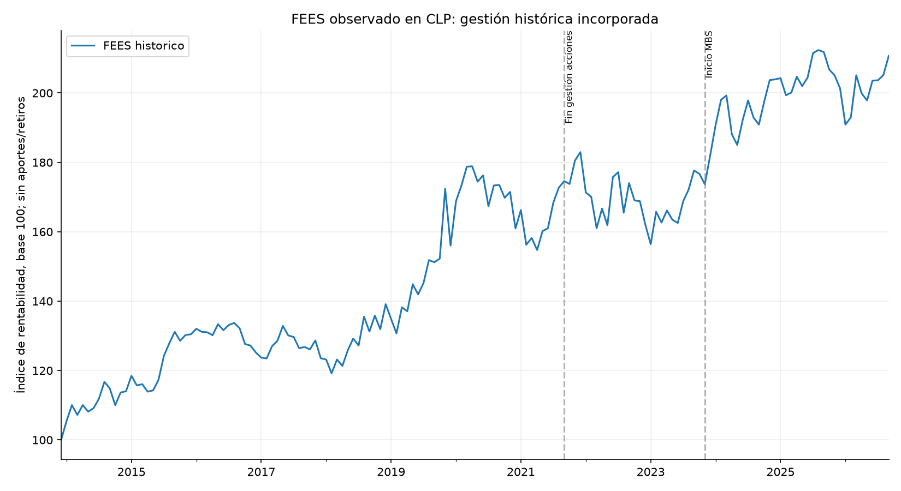
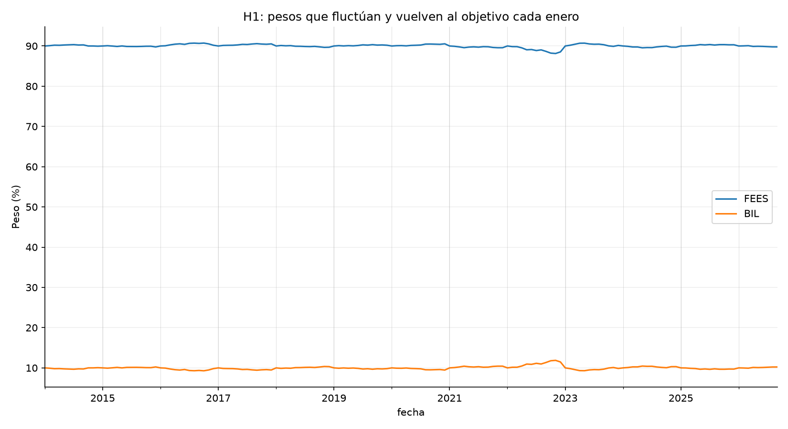
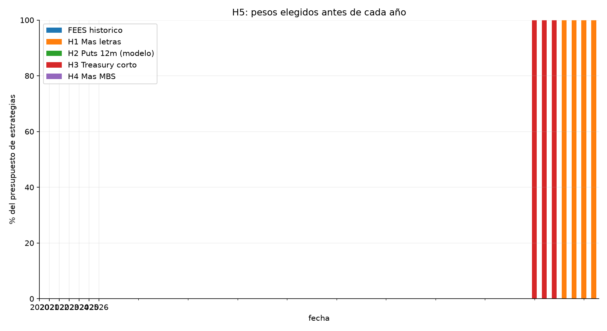
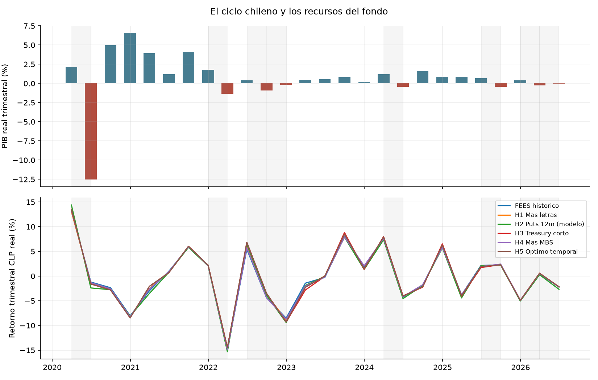
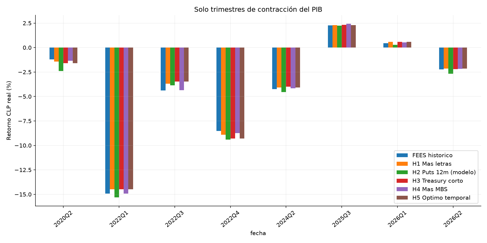
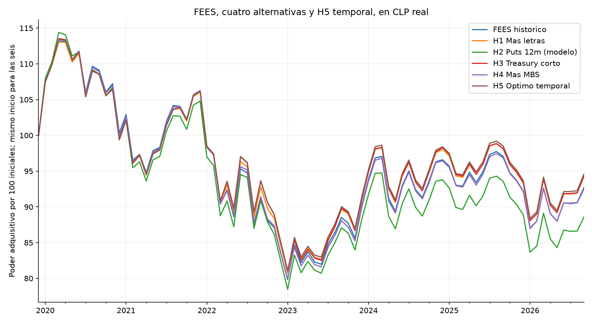
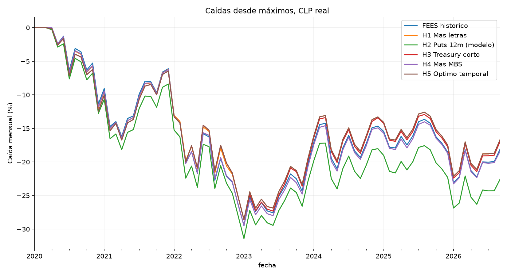
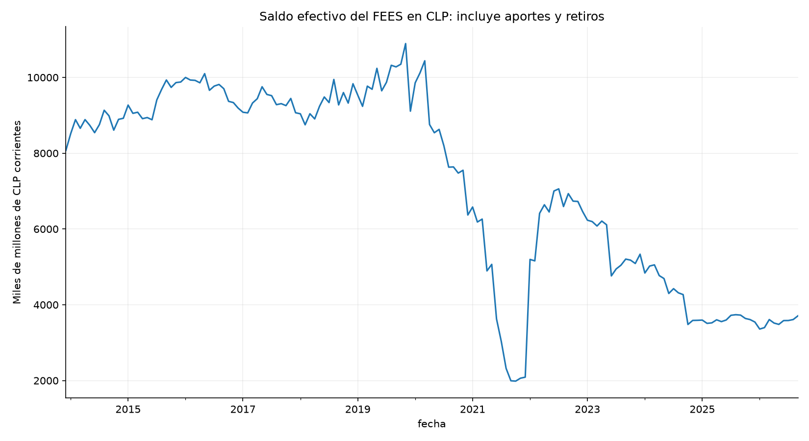
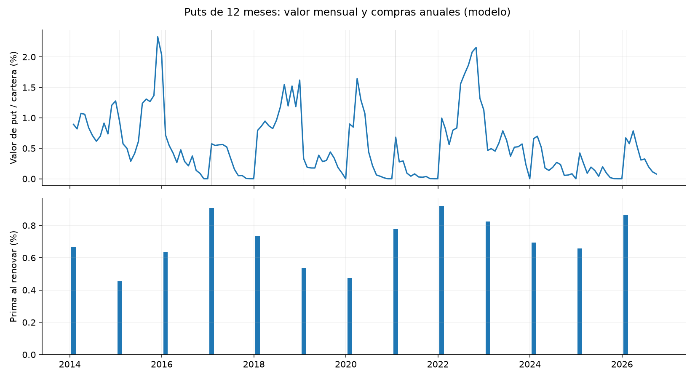

# FEES y protección anticíclica en pesos

Se estudia si el fondo conserva poder adquisitivo en CLP durante contracciones chilenas. La quinta alternativa combina FEES observado y cuatro estrategias. Es un óptimo condicionado al objetivo, a una rejilla de pesos de 5% y a los supuestos del modelo; no una garantía de mejor comportamiento futuro.

## Datos y referencia completa

Retornos oficiales del FEES: 2014-01-31 a 2026-09-30, 153 meses, extraídos de informes oficiales. El FEES histórico incorpora sus políticas, operaciones y rebalanceos efectivos. No es la antigua proxy de 69%. Se convierte con dólar observado diario BCCh tomado al último día disponible de cada mes y se deflacta con IPC mensual publicado por BCCh, fuente INE. El PIB es real trimestral desestacionalizado; se evalúa hasta 2026-06-30, último trimestre común publicado.

Los retornos USD están redondeados a 0,01 puntos porcentuales en los PDF. No se usa la variación del saldo del fondo como retorno ni se imputa un retorno diario inexistente. El dólar observado corresponde a transacciones del día hábil anterior; no coincide necesariamente con el cierre FX usado por Hacienda. Por eso esta conversión CLP puede diferir del retorno CLP oficial.

Las líneas señalan fin de gestión de acciones (27/9/2021) e inicio de MBS (2/11/2023), documentados en informes; no son un calendario exhaustivo de todos los rebalanceos reales. No se inventaron fechas operativas. El FEES histórico incluía acciones antes de 2021.

## Las cuatro alternativas sobre el 100% del presupuesto

| Estrategia | Regla fijada antes de la comparación actual |
| --- | --- |
| H1 Más letras | 90% FEES observado + 10% BIL |
| H2 Puts largas | FEES observado, vendiendo parte para pagar put de 12 meses y sus costos; nocional 10%, strike 95% del futuro sintético inicial |
| H3 Treasury corto | 80% FEES observado + 20% SHY (Treasury 1–3 años) |
| H4 Más MBS | 90% FEES observado + 10% MBB; también se conserva una sensibilidad de reducción MBS desde su introducción |

Este diseño de núcleo y satélites reemplaza los cambios sobre la antigua cartera parcial. Los pesos técnicos son propuestas del asistente. H4 prueba mayor exposición; la reducción adicional de 2 pp desde diciembre de 2023 está en `sensibilidad_menos_mbs.csv`, rotulada como atribución marginal proxy, no cartera observada.

H1, H3 y H4 rebalancean en enero; entre fechas los pesos fluctúan. Sus costos son 5 pb por dólar comprado o vendido, incluida compra inicial. FEES observado ya es neto de sus comisiones. H5 tiene una capa adicional de 5 pb sobre el volumen de reasignación entre estrategias. No se confunde valoración mensual con rebalanceo mensual.

## Quinta alternativa: objetivo y pesos

Se enumeraron 7566 combinaciones de cinco presupuestos. Los pesos suman uno, no hay cortos ni endeudamiento. Se permite 0%–100% en las estrategias sin puts y hasta 25% en H2 por incertidumbre de valoración. No se exige invertir en todas ni se fuerza una diversificación aparente: las estrategias comparten FEES. El tope de H2 es un supuesto del experimento, no una regla legal.

Objetivo: **maximizar el peor retorno trimestral en CLP real entre trimestres con caída del PIB real**. Se desempata por mayor media en contracciones y después menor concentración. El retorno total no entra en la función objetivo. Se exige un mínimo de 20 trimestres y tres contracciones conocidas para ajustar pesos.

Pesos finales estimados después del cierre de 2026-09-30, para decisiones posteriores. **No se aplican retrospectivamente para fabricar la curva de H5.**

|                      |   peso_pct |
|:---------------------|-----------:|
| FEES historico       |          0 |
| H1 Mas letras        |        100 |
| H2 Puts 12m (modelo) |          0 |
| H3 Treasury corto    |          0 |
| H4 Mas MBS           |          0 |

Como sensibilidad se impone un mínimo de 20% en FEES explícito y máximo de 60% por estrategia, manteniendo el tope H2 de 25%. Estos límites adicionales cambian el problema y pueden generar una mezcla distinta; no se presentan como restricciones oficiales.

|                      |   peso_pct |
|:---------------------|-----------:|
| FEES historico       |         20 |
| H1 Mas letras        |         60 |
| H2 Puts 12m (modelo) |          0 |
| H3 Treasury corto    |         20 |
| H4 Mas MBS           |          0 |

La gráfica H5 usa selección progresiva anual: en cada enero solo se consideran retornos anteriores y trimestres cuyo cierre más 90 días es anterior a la decisión. La evaluación empieza en 2020-01-31. El PIB es revisado, no una base de primeras publicaciones archivadas; el rezago evita usar trimestres futuros pero no elimina sesgo por revisiones. Las hipótesis se diseñaron con conocimiento de este pasado. Es evaluación temporal retrospectiva, no una prueba independiente en tiempo real.

Exposición antes de pagar prima, como fracción del presupuesto final. El nocional de opción no se suma a los activos; H2 paga su prima reduciendo el núcleo FEES. El núcleo a su vez conserva las exposiciones cambiantes del FEES histórico.

|                                   |   0 |
|:----------------------------------|----:|
| Nucleo FEES antes de prima        | 0.9 |
| BIL                               | 0.1 |
| SHY                               | 0   |
| MBB                               | 0   |
| Nocional put (no sumar a activos) | 0   |

`sensibilidad_excluir_contraccion.csv` vuelve a elegir pesos retirando un trimestre adverso cada vez. `ranking_optimizacion.csv` muestra las 30 mejores mezclas. Si cambian mucho los pesos o las puntuaciones son muy parecidas, no se justifica tratar la solución como única o estable.

Hay 21 candidatos a no más de 0,02 pp trimestrales del mejor peor-retorno de entrenamiento. Ese margen es una sensibilidad descriptiva, no otro criterio para escoger pesos. La precisión de los PDF y la alta superposición de estrategias impiden atribuir importancia económica a diferencias de pocas milésimas de punto porcentual.

## Comportamiento durante contracciones

La siguiente comparación usa el mismo período temporal para las seis carteras y solo trimestres completos con PIB publicado. Rentabilidades en CLP real, porcentajes trimestrales. La correlación con PIB se reporta como descripción; el objetivo no fuerza una correlación negativa.

|                      |   media_contraccion_pct |   peor_contraccion_pct |   trimestres_contraccion_con_perdida |   media_expansion_pct |   correlacion_PIB |   contracciones_observadas |
|:---------------------|------------------------:|-----------------------:|-------------------------------------:|----------------------:|------------------:|---------------------------:|
| FEES historico       |                  -4.096 |                -14.922 |                                    6 |                 1.515 |             0.085 |                          8 |
| H1 Mas letras        |                  -3.983 |                -14.478 |                                    6 |                 1.546 |             0.085 |                          8 |
| H2 Puts 12m (modelo) |                  -4.46  |                -15.31  |                                    6 |                 1.461 |             0.111 |                          8 |
| H3 Treasury corto    |                  -4.021 |                -14.485 |                                    6 |                 1.577 |             0.088 |                          8 |
| H4 Mas MBS           |                  -4.096 |                -14.918 |                                    6 |                 1.521 |             0.087 |                          8 |
| H5 Optimo temporal   |                  -4.028 |                -14.485 |                                    6 |                 1.594 |             0.088 |                          8 |

En la evaluación temporal, H5 registra pérdidas en 6 de 8 contracciones. Su retorno medio en contracciones es -4.028% y el peor es -14.485%. Su correlación con el crecimiento del PIB es 0.088. **No se demuestra un portafolio anticíclico que preserve capital en todas las contracciones.** La selección mejora el objetivo de entrenamiento bajo límites, pero su protección observada es limitada. Las estrategias comparten gran parte del núcleo y la exposición al tipo de cambio.

El bootstrap por bloques de cuatro trimestres, 2.000 repeticiones, estima la diferencia de retorno medio H5 menos FEES durante contracciones: 0.067 pp trimestrales; intervalo descriptivo del 95% [-0.203, 0.311]. No reestima todo el proceso de selección, no incluye incertidumbre de primas y no corrige múltiples comparaciones. Hay pocos episodios adversos.

Como contexto, estas métricas mensuales usan el mismo período de evaluación y CLP real. No determinan la elección de pesos.

|                      |   retorno_anual_pct |   volatilidad_anual_pct |   caida_max_mensual_pct |   peor_mes_pct |
|:---------------------|--------------------:|------------------------:|------------------------:|---------------:|
| FEES historico       |              -1.117 |                  11.743 |                 -29.474 |         -7.711 |
| H1 Mas letras        |              -0.877 |                  11.789 |                 -28.585 |         -7.323 |
| H2 Puts 12m (modelo) |              -1.781 |                  12.095 |                 -31.41  |         -7.573 |
| H3 Treasury corto    |              -0.865 |                  11.844 |                 -28.59  |         -7.276 |
| H4 Mas MBS           |              -1.15  |                  11.729 |                 -29.453 |         -7.715 |
| H5 Optimo temporal   |              -0.824 |                  11.851 |                 -28.586 |         -7.276 |

El saldo efectivo es otra medida: incluye aportes y retiros que sirven para financiar al Fisco. Una caída de este saldo no se interpreta automáticamente como pérdida financiera. El nivel se convierte a CLP con el mismo tipo de cambio oficial.

## Puts de largo plazo

Se compra en enero, se mantiene strike y cantidad durante 12 meses y se valora mensualmente con el plazo restante. Al vencer se liquida en efectivo en el modelo y se renueva; la última opción no vencida conserva su valor de mercado teórico. La prima y fricción del 10% de la prima se financian vendiendo parte del FEES. Se incluye el retorno sacrificado de ese capital y no se cuenta el pago dos veces.

No se consiguieron primas ni una curva histórica por contratos COMEX identificados. Se utiliza HG=F como proxy de spot para construir un **futuro sintético con vencimiento fijo**: `F(t,T)=proxy(t)*exp(r*(T-t))`, suponiendo almacenaje menos conveniencia cero. El proxy continuo puede introducir efectos de cambio de contrato; no se afirma haber eliminado ese riesgo de base ni replicado una opción negociable. La volatilidad de compra usa 24 retornos mensuales previos, anualizados y multiplicados por 1,25; se mantiene fija para valorar ese contrato. Las tasas son DGS1 para 12 meses y DGS6MO para 6 meses. Black-76 es europeo; no modela ejercicio americano ni entrega de futuros.

La siguiente sensibilidad mantiene H2 separado de la optimización: plazos 6/12 meses y multiplicadores de volatilidad 1/1,25/1,5. No se escoge el mejor supuesto para volver a optimizar la historia.

|   plazo_meses |   multiplicador_vol |   media_contraccion_pct |   peor_contraccion_pct |   trimestres_contraccion_con_perdida |   media_expansion_pct |   correlacion_PIB |   contracciones_observadas |
|--------------:|--------------------:|------------------------:|-----------------------:|-------------------------------------:|----------------------:|------------------:|---------------------------:|
|             6 |                1    |                  -1.175 |                -15.236 |                                   10 |                 1.183 |             0.066 |                         17 |
|             6 |                1.25 |                  -1.239 |                -15.31  |                                   10 |                 1.112 |             0.064 |                         17 |
|             6 |                1.5  |                  -1.305 |                -15.375 |                                   10 |                 1.039 |             0.063 |                         17 |
|            12 |                1    |                  -1.116 |                -15.258 |                                   10 |                 1.209 |             0.06  |                         17 |
|            12 |                1.25 |                  -1.166 |                -15.31  |                                   10 |                 1.161 |             0.058 |                         17 |
|            12 |                1.5  |                  -1.215 |                -15.355 |                                   10 |                 1.111 |             0.057 |                         17 |

## Admisibilidad y límites

El objetivo económico no certifica admisibilidad. Puts de cobre no figuran en los instrumentos elegibles consultados. Los satélites alteran asignación y composición; H5 hereda esas limitaciones. Las bandas MBS 13%–17% aparecen en el informe anual 2024, p.33, y 2023, p.32; la pauta enlazada como vigente de 2023 describe otro rebalanceo. Se documenta esa diferencia de fuentes, sin presumir autorizaciones. No hay certificación de TE ex ante, ejecutabilidad ni autorización para invertir en ETFs.

La protección de poder adquisitivo del fondo durante contracciones es una aproximación a su mandato. No se han modelado ingresos fiscales del cobre, necesidades de caja ni financiación de retiros concretos. La mejor mezcla de esta rejilla y muestra puede ser peor en una crisis distinta. El análisis se limita al FEES, conforme a la instrucción del usuario; no incluye FRP.

Fuentes: [Hacienda, informes FEES](https://www.hacienda.cl/areas-de-trabajo/finanzas-internacionales/fondos-soberanos/fondo-de-estabilizacion-economica-y-social/informes-mensuales), [BCCh dólar observado](https://si3.bcentral.cl/Bdemovil/BDE/Series/MOV_ID_TC1), [BCCh IPC mensual](https://si3.bcentral.cl/Bdemovil/BDE/Series/MOV_SC_PR1), [BCCh PIB real](https://si3.bcentral.cl/siete/ES/Siete/Cuadro/CAP_CCNN/MN_CCNN76/CCNN2018_P0_V2?idSerie=F032.PIB.FLU.R.CLP.EP18.Z.Z.1.T), Yahoo ETF y cobre, FRED DGS1/DGS6MO. Los textos extraídos, páginas, URLs y hashes están en data/oficial. Se detectó que el enlace Hacienda de julio 2016 devolvía junio; se utilizó el informe correcto de [DIPRES](https://www.dipres.gob.cl/598/articles-149467_doc_pdf.pdf).
