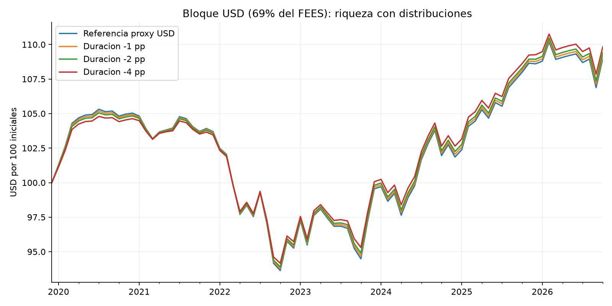
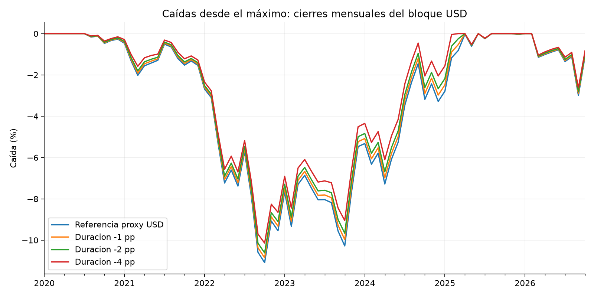
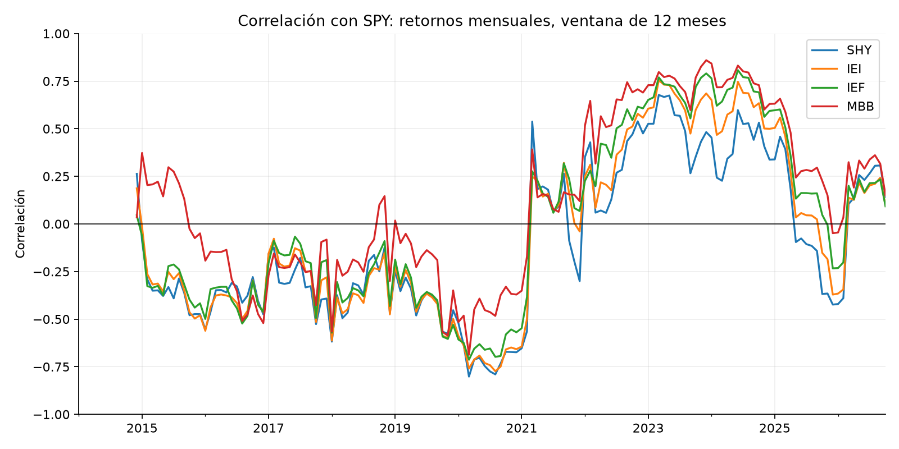

# FEES: resultados exploratorios para el Comité Financiero

Ejecución reproducible: `python analisis.py`. Corte solicitado: 2026-10-31; último cierre mensual: 2026-10-31; 82 retornos mensuales desde enero de 2020. Consulta de reglas: 8 de noviembre de 2026.

## Qué permite concluir este ejercicio

La política defensiva del FEES es coherente con disponer de recursos líquidos durante estrés fiscal. Este análisis parcial no prueba que su cartera completa sea óptima. Mantener el 15% estratégico de MBS y excluir puts de cobre respeta las directrices consultadas. Acortar duración merece evaluar el presupuesto de riesgo ex ante; estos resultados por sí solos no autorizan una operación.

La referencia es una **aproximación del bloque USD, que representa 69% de la asignación estratégica**. No es el retorno efectivo del FEES ni su benchmark oficial. No se modelan Europa (19%), Japón (9%) ni China (3%). Los resultados se expresan por 100 invertidos en ese bloque, sin multiplicarlos y presentarlos como retornos del fondo completo.

## Las cuatro ideas

1. **Bonos y acciones:** la tabla siguiente muestra cuándo aumentó la correlación y cuánto depende del bono y del período. Correlación positiva no equivale a ausencia total de diversificación. SPY es solo diagnóstico y no integra ninguna cartera.
2. **Puts sobre futuros del cobre:** excluidas porque no figuran en la lista de instrumentos elegibles. No se simulan primas ni se presenta un backtest de opciones inexistente.
3. **Treasuries más cortos:** se comparan traspasos de 1, 2 y 4 puntos porcentuales del fondo desde la proxy 7–10 años a 1–3 años. Se conservan el 40% de Treasuries y los demás pesos estratégicos. El tracking error realizado solo permite un diagnóstico preliminar.
4. **Más o menos MBS:** no se cambia el 15% de la asignación estratégica. Las directrices no ofrecen una banda táctica general para esta decisión. Una investigación sobre un cambio de política queda fuera de la restricción del usuario.

## Retorno y riesgo del bloque USD

Porcentajes anuales salvo caída máxima y peor mes. La caída se mide en cierres mensuales e incluye el capital inicial. La diferencia es entre retornos geométricos anualizados. El TE es un diagnóstico anualizado en puntos base sobre el bloque soberano 85%, suponiendo idéntico el resto de las exposiciones.

|                      |   retorno_anual_pct |   volatilidad_anual_pct |   caida_max_mensual_pct |   peor_mes_pct |   diferencia_cagr_pp |   te_proxy_soberano_pb | filtro_te_realizado_25pb   |
|:---------------------|--------------------:|------------------------:|------------------------:|---------------:|---------------------:|-----------------------:|:---------------------------|
| Referencia proxy USD |               1.268 |                   4.018 |                 -11.088 |         -2.965 |                0     |                  0     | pasa solo diagnostico      |
| Duracion -1 pp       |               1.297 |                   3.939 |                 -10.852 |         -2.914 |                0.029 |                  6.783 | pasa solo diagnostico      |
| Duracion -2 pp       |               1.326 |                   3.861 |                 -10.617 |         -2.863 |                0.058 |                 13.566 | pasa solo diagnostico      |
| Duracion -4 pp       |               1.384 |                   3.704 |                 -10.144 |         -2.76  |                0.115 |                 27.132 | supera 25 pb               |

La referencia devuelve 1.27% anual, con volatilidad 4.02% y caída máxima mensual -11.09%. Revisar todas las alternativas; no escoger la mejor como pronóstico. Incluso un TE realizado inferior a 25 pb **no demuestra** cumplimiento ex ante, ni elegibilidad legal de ETFs.

Como ejemplo intermedio fijado en el diseño, el traspaso de 2 pp devuelve 1.33% anual y reduce la caída máxima mensual a -10.62%. Su mejora de CAGR es 5.78 pb anuales del bloque USD. El intervalo de la diferencia de medias, con bloques de seis meses, va de -0.065 a 0.157 pp anuales e incluye cero. La evidencia no basta para recomendar el cambio por retorno esperado. Se descartan preliminarmente los escenarios que superan el diagnóstico de 25 pb: Duracion -4 pp: 27.13 pb. Los demás siguen requiriendo comprobación oficial ex ante.

## Correlación de bonos con acciones

Correlaciones entre retornos totales mensuales en USD. Tamaños de muestra, meses con pérdidas conjuntas y retornos de bonos cuando SPY cae están en `correlaciones.csv`. La muestra de 2022 solo tiene 12 meses.

| periodo    |    IEF |    IEI |    MBB |    SHY |
|:-----------|-------:|-------:|-------:|-------:|
| 2014-2019  | -0.338 | -0.347 | -0.165 | -0.322 |
| 2020-2021  | -0.373 | -0.477 | -0.205 | -0.577 |
| 2022       |  0.607 |  0.558 |  0.69  |  0.475 |
| 2023-corte |  0.44  |  0.359 |  0.519 |  0.249 |

## Sensibilidad e incertidumbre

Las ventanas se fijan por calendario, sin buscar el punto de quiebre más favorable. Cada ventana reinicia la inversión y cobra su compra inicial. Son comparaciones retrospectivas; los datos recientes ya inspiraron las hipótesis. No constituyen una prueba fuera de muestra.

| cartera              |   retorno_anual_pct |   volatilidad_anual_pct |   caida_max_mensual_pct |   peor_mes_pct | periodo    |   meses |
|:---------------------|--------------------:|------------------------:|------------------------:|---------------:|:-----------|--------:|
| Referencia proxy USD |               2.239 |                   2.207 |                  -2.403 |         -1.776 | 2014-2019  |      72 |
| Duracion -1 pp       |               2.2   |                   2.145 |                  -2.316 |         -1.721 | 2014-2019  |      72 |
| Duracion -2 pp       |               2.161 |                   2.083 |                  -2.229 |         -1.667 | 2014-2019  |      72 |
| Duracion -4 pp       |               2.082 |                   1.959 |                  -2.057 |         -1.558 | 2014-2019  |      72 |
| Referencia proxy USD |               1.831 |                   2.126 |                  -2.02  |         -0.859 | 2020-2021  |      24 |
| Duracion -1 pp       |               1.801 |                   2.061 |                  -1.911 |         -0.825 | 2020-2021  |      24 |
| Duracion -2 pp       |               1.772 |                   1.998 |                  -1.801 |         -0.792 | 2020-2021  |      24 |
| Duracion -4 pp       |               1.713 |                   1.871 |                  -1.582 |         -0.725 | 2020-2021  |      24 |
| Referencia proxy USD |              -8.18  |                   5.631 |                  -9.745 |         -2.965 | 2022       |      12 |
| Duracion -1 pp       |              -8.014 |                   5.526 |                  -9.566 |         -2.914 | 2022       |      12 |
| Duracion -2 pp       |              -7.848 |                   5.422 |                  -9.387 |         -2.863 | 2022       |      12 |
| Duracion -4 pp       |              -7.516 |                   5.213 |                  -9.027 |         -2.76  | 2022       |      12 |
| Referencia proxy USD |               3.563 |                   4.056 |                  -3.672 |         -1.898 | 2023-corte |      46 |
| Duracion -1 pp       |               3.582 |                   3.977 |                  -3.541 |         -1.858 | 2023-corte |      46 |
| Duracion -2 pp       |               3.602 |                   3.898 |                  -3.411 |         -1.817 | 2023-corte |      46 |
| Duracion -4 pp       |               3.64  |                   3.74  |                  -3.15  |         -1.736 | 2023-corte |      46 |

Bootstrap pareado por bloques circulares, 2000 repeticiones y semilla 20261108. Los intervalos describen la **diferencia de medias mensuales multiplicada por 12**, en puntos porcentuales anuales; no la diferencia de CAGR. Se muestran bloques de 3, 6 y 12 meses. Son intervalos individuales del 95%, sin ajuste por comparaciones múltiples. No se usan para declarar ganadores ni significancia conjunta.

| cartera        |   bloque_meses |   media_anualizada_pp |   ic95_inferior_pp |   ic95_superior_pp |
|:---------------|---------------:|----------------------:|-------------------:|-------------------:|
| Duracion -1 pp |              3 |                 0.025 |             -0.038 |              0.092 |
| Duracion -1 pp |              6 |                 0.025 |             -0.033 |              0.079 |
| Duracion -1 pp |             12 |                 0.025 |             -0.026 |              0.077 |
| Duracion -2 pp |              3 |                 0.051 |             -0.076 |              0.185 |
| Duracion -2 pp |              6 |                 0.051 |             -0.065 |              0.157 |
| Duracion -2 pp |             12 |                 0.051 |             -0.052 |              0.153 |
| Duracion -4 pp |              3 |                 0.102 |             -0.152 |              0.369 |
| Duracion -4 pp |              6 |                 0.102 |             -0.13  |              0.314 |
| Duracion -4 pp |             12 |                 0.102 |             -0.104 |              0.306 |

## Moneda relevante para el Fisco

Conversión ilustrativa: `(1 + retorno USD) × (1 + variación CLP por USD) − 1`, usando CLP=X (USD/CLP) de Yahoo. El cierre cambiario disponible puede diferir del horario del ETF y del dólar observado del Banco Central. Esto muestra la importancia del peso, pero no mide la cobertura de retiros fiscales ni de ingresos del cobre.

|                      |   retorno_anual_pct |   volatilidad_anual_pct |   caida_max_mensual_pct |   peor_mes_pct |
|:---------------------|--------------------:|------------------------:|------------------------:|---------------:|
| Referencia proxy USD |               5.806 |                  12.934 |                 -17.981 |         -7.76  |
| Duracion -1 pp       |               5.836 |                  12.931 |                 -17.914 |         -7.74  |
| Duracion -2 pp       |               5.866 |                  12.93  |                 -17.848 |         -7.721 |
| Duracion -4 pp       |               5.926 |                  12.928 |                 -17.715 |         -7.683 |

## Supuestos que afectan la interpretación

- La distribución actual se aplica al pasado como contrafactual, incluso antes de su implementación en noviembre de 2023. No se afirma que regía en 2020.
- Treasuries: un tercio de cada tramo SHY, IEI e IEF dentro del 40%, supuesto explícito. No son los pesos por capitalización del índice oficial. STIP cubre 0–5 años y no replica TIPS 1–10 años. MBB y BIL tampoco replican exactamente sus comparadores oficiales. Los ETFs son instrumentos de medición, no órdenes propuestas para el FEES.
- Cierres ajustados de Yahoo aproximan retorno total con distribuciones reinvertidas, netos de gastos internos del ETF. La validación contrasta cada retorno diario con cierre y distribución. No se suman dividendos otra vez.
- Rebalanceo mensual a pesos fijos, sin aportes ni retiros, costo de 5 pb por dólar comprado o vendido, incluida compra inicial. No hay impuesto, spread dinámico, deslizamiento ni comisión oficial FEES. `sensibilidad_costos.csv` muestra 0, 5 y 10 pb. La norma exige al menos un rebalanceo anual sin flujos, no este calendario mensual.
- El TE proxy usa la volatilidad histórica de la diferencia SHY–IEF, multiplicada por el traspaso y dividida por 85%. No incorpora el riesgo de réplica de la referencia frente al índice oficial. No reemplaza la matriz de riesgo ni el cálculo diario del custodio.
- Frecuencia mensual: volatilidad anualizada con raíz de 12 y observaciones equiponderadas. Los máximos intrames y los costos de liquidación en crisis pueden ser mayores.
- Cambios en tasas FRED solo sirven de contexto; nunca se usan como retornos de bonos. Datos originales, fechas y SHA-256 están en `data/metadatos.json`.

## Fuentes y archivos para revisar

[Política y asignación oficial](https://www.hacienda.cl/areas-de-trabajo/finanzas-internacionales/fondos-soberanos/fondo-de-estabilizacion-economica-y-social/politica-de-inversion), [directrices vigentes, oficio 1085/2023](https://www.hacienda.cl/areas-de-trabajo/finanzas-internacionales/fondos-soberanos/fondo-de-estabilizacion-economica-y-social/politica-de-inversion/pauta-de-inversion-vigente), [composición oficial de septiembre de 2026](https://www.hacienda.cl/areas-de-trabajo/finanzas-internacionales/fondos-soberanos/fondo-de-estabilizacion-economica-y-social/informacion-financiera/composicion-actual), [Yahoo USD/CLP](https://finance.yahoo.com/quote/CLP=X/), [FRED DGS2](https://fred.stlouisfed.org/series/DGS2), [FRED DGS10](https://fred.stlouisfed.org/series/DGS10). Los enlaces de cada descarga Yahoo están en el manifiesto. Las reglas con páginas y la tabla de proxies están en `docs/reglas-fees.md` y `docs/metodologia.md`.

Este trabajo cubre FEES parcialmente. El FRP sigue pendiente y el encargo del curso requiere ambos fondos. La revisión y defensa del equipo, el memo final y las firmas del anexo de IA siguen pendientes.
