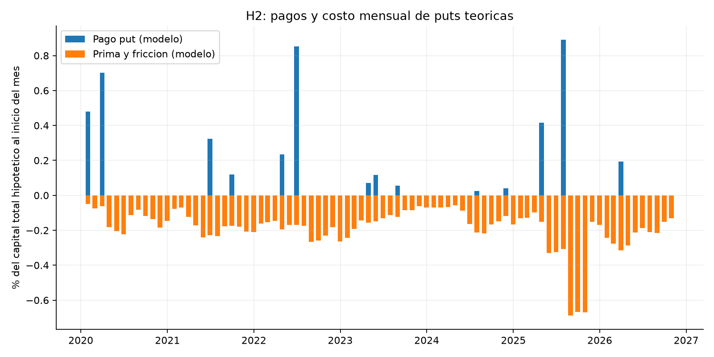

# FEES: una cartera por hipótesis

Se comparan **una referencia y cuatro carteras distintas**, una por idea del usuario. Datos hasta 2026-10-31, 82 meses desde enero de 2020. Ejecutar `python analisis.py` para regenerar todas las cifras.

La referencia aproxima el bloque USD de **69%** de la asignación estratégica. Faltan Europa 19%, Japón 9% y China 3%. Las métricas son por 100 invertidos en ese bloque y no representan el retorno del FEES completo. La política actual aplicada al pasado es un contrafactual, incluso antes de noviembre de 2023.

**H2 incluye primas y pagos teóricos de puts, no precios históricos observados de opciones.** Se incorpora para estudiar la idea, con su costo y sus límites. Simularla no significa que esté autorizada por la política vigente.

## Diseño de las cuatro carteras

- **H1, más letras:** mover 10 pp del fondo desde Treasury 7–10 años (IEF) hacia letras (BIL). Es la traducción propuesta por el asistente de reducir exposición a bonos largos cuando su correlación con acciones preocupa. No incorpora acciones ni activa señales según correlaciones futuras. Cambia la asignación estratégica.
- **H2, puts de cobre:** conservar la cartera de referencia y comprar puts hipotéticas cada mes. Nocional equivalente a 10% del fondo, strike 95% del precio inicial y plazo 1/12 de año. La prima y fricción se financian reduciendo BIL ese mes. No se posee un futuro descubierto.
- **H3, menor duración:** mover 2 pp desde IEF hacia SHY (Treasury 1–3 años). Conservar el 40% total de Treasuries, el 10% de letras y el 15% MBS.
- **H4, menos MBS:** reducir MBB del 15% al 10% y subir BIL del 10% al 15%. La sensibilidad también prueba 20% MBS. Estos cambios requieren modificar la asignación.

Pesos sobre el fondo completo, **no normalizados**. Suman 69%; el 31% no modelado se supone idéntico entre escenarios. La última columna es nocional subyacente de la opción y no se suma a los pesos de activos. La prima efectiva de H2 varía cada mes y se descuenta de BIL.

|                        |   BIL |    SHY |    IEI |    IEF |   STIP |   MBB |   nocional_put_pct |
|:-----------------------|------:|-------:|-------:|-------:|-------:|------:|-------------------:|
| Referencia proxy USD   |    10 | 13.333 | 13.333 | 13.333 |      4 |    15 |                  0 |
| H1 Mas letras          |    20 | 13.333 | 13.333 |  3.333 |      4 |    15 |                  0 |
| H2 Puts cobre (modelo) |    10 | 13.333 | 13.333 | 13.333 |      4 |    15 |                 10 |
| H3 Treasury corto      |    10 | 15.333 | 13.333 | 11.333 |      4 |    15 |                  0 |
| H4 Menos MBS           |    15 | 13.333 | 13.333 | 13.333 |      4 |    10 |                  0 |

## Filtro normativo

| cartera                | hipotesis                            | estado_normativo                                                | evidencia                                  |
|:-----------------------|:-------------------------------------|:----------------------------------------------------------------|:-------------------------------------------|
| Referencia proxy USD   | Referencia                           | Referencia proxy; cumplimiento no certificado                   | Retornos ETF proxy                         |
| H1 Mas letras          | 1. Menor dependencia de bonos largos | Requiere cambiar asignacion y evaluar riesgo ex ante            | Retornos ETF proxy                         |
| H2 Puts cobre (modelo) | 2. Cobertura con puts de cobre       | Instrumento fuera de la politica consultada; simulacion teorica | Primas teoricas, subyacente continuo proxy |
| H3 Treasury corto      | 3. Menor duracion Treasury           | Pesos de clases conservados; TE ex ante no verificado           | Retornos ETF proxy                         |
| H4 Menos MBS           | 4. Menor ponderacion MBS             | Requiere cambiar el 15% estrategico de MBS                      | Retornos ETF proxy                         |

Las restricciones se mantienen como criterio de decisión: las carteras fuera de política se muestran como hipótesis y no se recomiendan para ejecución bajo las reglas actuales. Los ETFs son proxies, no órdenes elegibles certificadas. El TE realizado aproximado no reemplaza el cálculo ex ante del custodio. H2 y H4 no reciben un TE soberano, porque ese número no decidiría su admisibilidad.

## Comparación del bloque USD

Retorno compuesto y volatilidad anual en %, caída y peor mes en %. La caída incluye el capital inicial y solo observa cierres mensuales. Diferencia CAGR en puntos porcentuales; TE proxy en puntos base anuales del mandato soberano 85%, suponiendo idéntico el resto.

|                        |   retorno_anual_pct |   volatilidad_anual_pct |   caida_max_mensual_pct |   peor_mes_pct |   diferencia_cagr_pp |   te_proxy_soberano_pb |
|:-----------------------|--------------------:|------------------------:|------------------------:|---------------:|---------------------:|-----------------------:|
| Referencia proxy USD   |               1.268 |                   4.018 |                 -11.088 |         -2.965 |                0     |                  0     |
| H1 Mas letras          |               1.695 |                   3.01  |                  -7.904 |         -2.249 |                0.426 |                 85.21  |
| H2 Puts cobre (modelo) |              -1.009 |                   4.146 |                 -16.47  |         -3.342 |               -2.277 |                nan     |
| H3 Treasury corto      |               1.326 |                   3.861 |                 -10.617 |         -2.863 |                0.058 |                 13.566 |
| H4 Menos MBS           |               1.426 |                   3.587 |                  -9.94  |         -2.581 |                0.157 |                nan     |

## Qué produce la simulación de puts

Con los supuestos centrales, H2 devuelve -1.01% anual del bloque, con caída máxima mensual de -16.47%. La prima media anualizada es 2.02% del capital total hipotético tras el costo de rebalanceo de cada mes y los pagos medios anualizados son 0.66%. Son promedios mensuales por 12, no sumas de caja sobre un capital inicial constante.

Hubo 14 meses de caída del proxy del cobre superior a 5%. En ellos, la diferencia media H2 menos referencia fue 0.22 pp mensuales del bloque. Esto describe la protección frente a ese subyacente y el costo del seguro. **No demuestra cobertura de ingresos fiscales ni de todas las pérdidas de bonos.** No se modelan ingresos tributarios, producción ni retiros del FEES.

El CSV `puts_auditoria.csv` guarda para cada mes precio inicial y final, strike, volatilidad histórica conocida al entrar, volatilidad del modelo, tasa, prima, fricción, pago y retorno. Permite seguir el cálculo de un mes sin una caja negra.

La valoración usa **Black-76 europeo**, con volatilidad de los 63 retornos diarios anteriores multiplicada por 1.25. Ese multiplicador es un supuesto, no volatilidad implícita observada. Se añade fricción del 10% de la prima. Se descuenta el rendimiento BIL sacrificado al pagar prima y fricción. El programa rechaza una prima superior a las letras disponibles.

`HG=F` es un proxy continuo: el precio inicial y final pueden corresponder a vencimientos distintos. Por ello se simula una **opción europea hipotética sobre ese proxy**, no contratos COMEX históricos identificados. No se replica el rollover de un contrato negociable, el ejercicio americano, la entrega del futuro, la malla de strikes, el spread real ni contratos enteros de 25.000 libras. Los resultados son condicionales y no constituyen un backtest ejecutable de opciones reales.

## Sensibilidad del seguro y de MBS

La siguiente tabla mantiene el nocional de 10% y varía strike y multiplicador de volatilidad. `sensibilidad_puts.csv` contiene las 27 combinaciones de strikes 90/95/100%, volatilidad histórica por 1/1,25/1,5 y nocionales 5/10/20%. Se muestran todas sin elegir la mejor.

|   retorno_anual_pct |   volatilidad_anual_pct |   caida_max_mensual_pct |   peor_mes_pct |   strike |   multiplicador_vol |   nocional |
|--------------------:|------------------------:|------------------------:|---------------:|---------:|--------------------:|-----------:|
|               0.824 |                   4.015 |                 -11.58  |         -3.049 |     0.9  |                1    |        0.1 |
|               0.196 |                   4.026 |                 -12.719 |         -3.13  |     0.9  |                1.25 |        0.1 |
|              -0.592 |                   4.043 |                 -14.719 |         -3.225 |     0.9  |                1.5  |        0.1 |
|               0.119 |                   4.126 |                 -13.339 |         -3.218 |     0.95 |                1    |        0.1 |
|              -1.009 |                   4.146 |                 -16.47  |         -3.342 |     0.95 |                1.25 |        0.1 |
|              -2.198 |                   4.171 |                 -20.041 |         -3.471 |     0.95 |                1.5  |        0.1 |
|              -1.002 |                   4.25  |                 -16.243 |         -3.229 |     1    |                1    |        0.1 |
|              -2.398 |                   4.273 |                 -21.727 |         -3.373 |     1    |                1.25 |        0.1 |
|              -3.775 |                   4.3   |                 -28.748 |         -3.517 |     1    |                1.5  |        0.1 |

Para MBS, cada cambio se financia con letras. El 15% es la referencia oficial; 10% y 20% son alternativas hipotéticas que cambian la asignación.

|   retorno_anual_pct |   volatilidad_anual_pct |   caida_max_mensual_pct |   peor_mes_pct |   peso_mbs_sobre_fondo |
|--------------------:|------------------------:|------------------------:|---------------:|-----------------------:|
|               1.426 |                   3.587 |                  -9.94  |         -2.581 |                   0.1  |
|               1.268 |                   4.018 |                 -11.088 |         -2.965 |                   0.15 |
|               1.109 |                   4.453 |                 -12.224 |         -3.349 |                   0.2  |

## Correlación, estrés e incertidumbre

La primera hipótesis se evalúa con su propia cartera y con el diagnóstico de correlación. SPY solo se usa para diagnóstico. Una correlación positiva no implica ausencia total de diversificación.

| periodo    |    IEF |    IEI |    MBB |    SHY |
|:-----------|-------:|-------:|-------:|-------:|
| 2014-2019  | -0.338 | -0.347 | -0.165 | -0.322 |
| 2020-2021  | -0.373 | -0.477 | -0.205 | -0.577 |
| 2022       |  0.607 |  0.558 |  0.69  |  0.475 |
| 2023-corte |  0.44  |  0.359 |  0.519 |  0.249 |

Retornos acumulados en episodios fijados por calendario. H2 sigue dependiendo de primas teóricas.

|         |   Referencia proxy USD |   H1 Mas letras |   H2 Puts cobre (modelo) |   H3 Treasury corto |   H4 Menos MBS |
|:--------|-----------------------:|----------------:|-------------------------:|--------------------:|---------------:|
| 2020 T1 |                  4.289 |           2.85  |                    5.778 |               4.067 |          4.125 |
| 2022    |                 -8.134 |          -5.729 |                   -9.853 |              -7.802 |         -7.201 |

Bootstrap pareado circular con 2000 repeticiones y semilla 20261108. Aquí se muestran bloques de seis meses; `incertidumbre.csv` también incluye 3 y 12. Intervalos individuales del 95% para diferencias de **medias mensuales por 12**, en pp anuales, no diferencias de CAGR. No corrigen comparaciones múltiples ni la selección retrospectiva. En H2 tampoco incorporan error de valoración de opciones.

| cartera                |   bloque_meses |   media_anualizada_pp |   ic95_inferior_pp |   ic95_superior_pp |
|:-----------------------|---------------:|----------------------:|-------------------:|-------------------:|
| H1 Mas letras          |              6 |                 0.386 |             -0.366 |              1.081 |
| H2 Puts cobre (modelo) |              6 |                -2.269 |             -3.132 |             -1.427 |
| H3 Treasury corto      |              6 |                 0.051 |             -0.065 |              0.157 |
| H4 Menos MBS           |              6 |                 0.139 |             -0.109 |              0.412 |

`sensibilidad_periodos.csv` compara 2015–2019, 2020–2021, 2022 y 2023–corte con las mismas cinco carteras. La ventana anterior a 2020 comienza en 2015 para asegurar calentamiento de volatilidad del cobre. `sensibilidad_costos.csv` prueba 0/5/10 pb de costos de activos; la fricción propia de puts se mantiene separada.

## Moneda y límites

Conversión ilustrativa a CLP: `(1 + retorno USD) × (1 + cambio CLP por USD) − 1`, con Yahoo CLP=X. No es dólar observado y sus horarios pueden diferir del cierre de ETF.

|                        |   retorno_anual_pct |   volatilidad_anual_pct |   caida_max_mensual_pct |   peor_mes_pct |
|:-----------------------|--------------------:|------------------------:|------------------------:|---------------:|
| Referencia proxy USD   |               5.806 |                  12.934 |                 -17.981 |         -7.76  |
| H1 Mas letras          |               6.251 |                  12.96  |                 -17.355 |         -7.474 |
| H2 Puts cobre (modelo) |               3.426 |                  13.498 |                 -20.132 |         -7.979 |
| H3 Treasury corto      |               5.866 |                  12.93  |                 -17.848 |         -7.721 |
| H4 Menos MBS           |               5.97  |                  13.009 |                 -18.028 |         -7.665 |

Rebalanceo mensual, sin aportes ni retiros, con costo de 5 pb por dólar comprado o vendido, incluida la compra inicial. Los cierres ajustados aproximan reinversión de distribuciones y ya incluyen gastos internos de ETF. FRED DGS1MO se usa solo como proxy de descuento para la prima; DGS2/DGS10 dan contexto. Ninguna variación de tasas se interpreta como retorno de bonos.

La referencia divide el 40% Treasury en tercios SHY/IEI/IEF, supuesto que no replica ponderaciones por capitalización. STIP es TIPS 0–5 años, distinto del comparador 1–10. Los demás ETF también tienen desajustes de índice, gastos y gestión. Sin índices oficiales ni cartera global no se certifica rendimiento efectivo ni cumplimiento del FEES. Las hipótesis se diseñaron con conocimiento del pasado; no hay validación independiente fuera de muestra.

## Fuentes

[Política FEES](https://www.hacienda.cl/areas-de-trabajo/finanzas-internacionales/fondos-soberanos/fondo-de-estabilizacion-economica-y-social/politica-de-inversion), [directrices vigentes](https://www.hacienda.cl/areas-de-trabajo/finanzas-internacionales/fondos-soberanos/fondo-de-estabilizacion-economica-y-social/politica-de-inversion/pauta-de-inversion-vigente), [Yahoo cobre](https://finance.yahoo.com/quote/HG=F/), [FRED DGS1MO](https://fred.stlouisfed.org/series/DGS1MO), [Black (1976)](https://doi.org/10.1016/0304-405X(76)90024-6), [CME: opciones de cobre](https://www.cmegroup.com/markets/metals/base/copper.contractSpecs.options.html), [CME: datos históricos DataMine](https://www.cmegroup.com/datamine.html). Las URLs exactas y hashes de las descargas están en `data/metadatos.json`.

El alcance académico completo también requiere FRP. Siguen pendientes la revisión y defensa del equipo, el memo final y las firmas del anexo IA.
